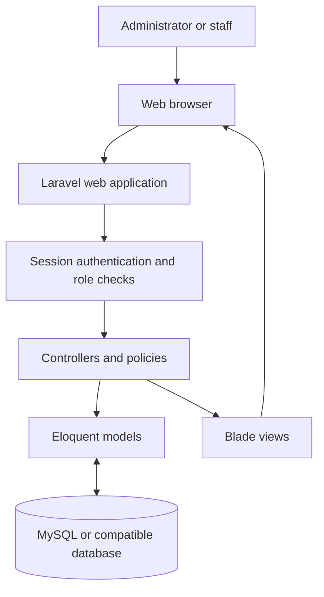
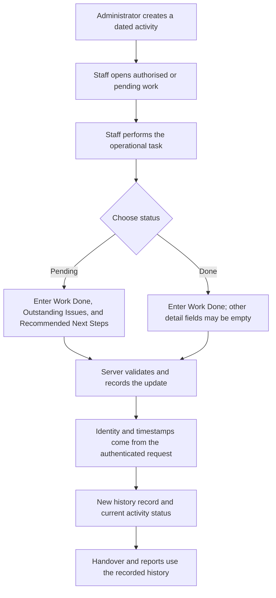

# Npontu SupportTrack

**Applications Support Activity Management System**

Npontu SupportTrack is a Laravel web application for recording operational support activities, tracking staff updates, handing over unfinished work, and reviewing activity history through date-based reports. It was independently developed as a technical project for the Npontu Technologies Platforms Developer assignment. The application is not deployed, and this project does not imply endorsement or adoption by Npontu Technologies.

> **Project status:** Local development and automated tests are supported. No hosted deployment is currently available.

## 1. Project title and introduction

This repository contains the Applications Support Activity Management System described below. It is an independently developed technical project for the Npontu Technologies Platforms Developer assignment.

## 2. Project overview

SupportTrack provides a shared record of application-support work. Administrators create official activities and personnel accounts. Staff record their progress as structured updates. Each update remains in the activity history, allowing the team to review who recorded what and when, and to carry pending work into a later handover.

## 3. Problem statement

Operational support work can be difficult to track when tasks, findings, and follow-up actions are recorded across separate channels. Teams need a consistent way to see what was done, what remains outstanding, who last updated the work, and how its status looked at an earlier date.

## 4. Project objectives

- Centralise dated support activities and their current status.
- Preserve a chronological, attributable record of staff updates.
- Make pending work visible across handovers without duplicating activity records.
- Provide role-aware activity views and historical reports.
- Require useful context when work remains pending.

## 5. Key features

- Session-based login for administrator and staff roles; public registration is not provided.
- Administrator-created activities with a date, description, and optional single staff assignee.
- Structured updates with Work Done, optional Findings, and status-dependent Outstanding Issues and Recommended Next Steps.
- Server-captured personnel attribution and timestamps; updates are appended to activity history.
- Daily handover views with historical status, latest update, pending carryover, and Awaiting Update state.
- Activity history, role-aware dashboards, filtered reports, and CSV export.
- Administrator-managed personnel accounts, activation state, role, and password reset.
- Staff profile page for changing the signed-in user's password.

**Not implemented:** activity priorities, activity editing or deletion, multi-person assignment, unplanned support-issue reporting, email-based password reset, and forced first-login password changes. Pending activities can be continued by another staff member through handover without reassignment.

## 6. User roles and permissions

| Role | Main capabilities |
| --- | --- |
| Administrator | View team dashboards, create activities, create and manage personnel accounts, review team activity and history, use reports, and export CSV. Administrators cannot submit activity updates through the staff update workflow. |
| Staff | View assigned or created activities, access pending/awaiting handover work, submit updates where authorised, view their own update history and scoped reports, and change their password. |

Authorization is enforced by middleware and activity policies on the server. See [docs/SECURITY.md](docs/SECURITY.md) for the implemented controls and limitations.

## 7. Technology stack

- PHP 8.2+
- Laravel 12 and Eloquent ORM
- MySQL or compatible MariaDB for a local/deployed database; the documented configuration uses MySQL
- Blade templates and directly served CSS in `public/css`
- SQLite in-memory database for automated tests
- Node.js/npm and Vite are optional for building the bundled frontend assets; the current interface does not require that build

## 8. System architecture

The browser sends authenticated web requests to Laravel. Controllers validate requests and apply policy checks, Eloquent models access the database, and Blade renders the response.



See [docs/ARCHITECTURE.md](docs/ARCHITECTURE.md) for the detailed component, update, and administrator workflows.

## 9. Application workflow



## 10. Database overview

The principal domain tables are `users`, `activities`, and `activity_updates`. Activities identify their creator and optional assignee. Each activity can have many updates; each update stores a status, structured details, and a snapshot of the submitting personnel. Handover is calculated from activities and updates rather than stored in a separate handover table.

The migrations also create Laravel support tables for sessions, cache, password-reset tokens, and queued jobs. The schema and delete rules are documented in [docs/DATABASE-DESIGN.md](docs/DATABASE-DESIGN.md).

## 11. Installation and setup

See the full [Windows/XAMPP and production setup guide](docs/DEPLOYMENT.md). In brief:

```powershell
git clone https://github.com/casioboi/npontu-supporttrack.git
cd npontu-supporttrack
composer install
Copy-Item .env.example .env
php artisan key:generate
```

Create a local database, set its connection in `.env`, then run migrations and start the application as described below. Keep `.env` private and untracked.

## 12. Environment configuration

The example environment uses `APP_TIMEZONE=Africa/Accra` and a MySQL database named `npontu-supporttrack`. Configure `DB_HOST`, `DB_PORT`, `DB_DATABASE`, `DB_USERNAME`, and `DB_PASSWORD` for your local environment. The example's blank database password is only a local XAMPP convenience; use a dedicated database account and secret storage in production.

Automated tests use the in-memory SQLite settings in `phpunit.xml`, not the MySQL credentials in `.env`.

## 13. Database migration and seeding

After creating and configuring the database:

```powershell
php artisan migrate --seed
```

The seeder creates an administrator only when `SUPPORTTRACK_ADMIN_EMAIL` and `SUPPORTTRACK_ADMIN_PASSWORD` are configured (and may use `SUPPORTTRACK_ADMIN_NAME`). Otherwise it does not create sample or default accounts. The recommended interactive bootstrap is:

```powershell
php artisan supporttrack:admin
```

This command prompts for the administrator's name, email, and a confirmed password without echoing the password. See [docs/DEPLOYMENT.md](docs/DEPLOYMENT.md) for details.

## 14. Running the application

```powershell
php artisan serve
```

Open [http://127.0.0.1:8000/login](http://127.0.0.1:8000/login). The repository has no public demo or deployed URL. Node.js is not needed to run the current Blade/CSS interface; if you intentionally build Vite assets, use `npm install` and `npm run build`.

## 15. System usage

- Administrators create personnel accounts and official activities.
- Staff open assigned work or pending work presented through Daily Handover.
- For **every** update, Work Done is required and Findings is optional.
- For **Pending** updates, Outstanding Issues and Recommended Next Steps are also required.
- For **Done** updates, Outstanding Issues and Recommended Next Steps may be empty.
- Reports filter activities by activity date and calculate status as of the selected end date; results can be exported as CSV.

For step-by-step instructions, see the [System User Guide](docs/SYSTEM-USER-GUIDE.md). Unplanned support issues cannot currently be submitted as a separate report in the application.

## 16. Security and access control

The application uses authenticated sessions, administrator middleware, activity policies, validated requests, CSRF protection from Laravel's web middleware, and hashed passwords. Identity and update timestamps are assigned by the server-side update handler. These controls do not replace secure deployment configuration or an independent security assessment. See [docs/SECURITY.md](docs/SECURITY.md).

## 17. Testing

Run the full suite with:

```powershell
php artisan test
```

The suite covers authentication, role boundaries, activity creation and updates, conditional validation, identity/timestamp handling, stale submissions, handover history and carryover, report filters and CSV scoping, and profile/personnel workflows. Tests use in-memory SQLite. The suite was run while preparing these documents: **34 tests passed, with 268 assertions**. See [docs/DEPLOYMENT.md](docs/DEPLOYMENT.md#testing).

## 18. Screenshots

No application screenshots are included yet. Add screenshots captured from a running instance only; do not use mockups as product screenshots. Recommended views are Login, Administrator Dashboard, Staff Dashboard, Activities, Activity Detail and Update Form, Activity History, Daily Handover, Reports, and Personnel Management. Remove or obscure real names, email addresses, and operational data before publishing.

## 19. Future improvements

Potential future work, not current functionality:

- Priority and multi-person assignment support.
- Activity editing, rescheduling, and lifecycle management.
- A dedicated unplanned support-issue reporting workflow.
- Email invitation and password reset flows, plus optional first-login password change.
- Broader integration, notification, and deployment automation.

## 20. Author and project information

- **Developer:** Shadrack Anim Amoafo
- **Degree:** BSc Information Technology
- **Institution:** Ghana Communication Technology University (GCTU)
- **GitHub:** [casioboi](https://github.com/casioboi)
- **LinkedIn:** [Shadrack Anim Amoafo](https://www.linkedin.com/in/shadrack-anim-amoafo-7a8300366)
- **Project:** Npontu SupportTrack
- **Purpose:** Applications Support Activity Management System
- **Assignment context:** Independently developed technical project for the Npontu Technologies Platforms Developer assignment. No official endorsement, deployment, or adoption is claimed.

Suggested GitHub repository description: “A Laravel-based Applications Support Activity Management System for tracking daily operational activities, staff updates, accountability, reporting and team handovers.”

Suggested topics: `laravel`, `php`, `mysql`, `applications-support`, `activity-tracking`, `team-handover`, `audit-trail`, `reporting-system`, `task-management`, `admin-dashboard`.

## 21. Licence

This project is distributed under the MIT License. See [LICENSE](LICENSE).

## Project documentation

- [Architecture](docs/ARCHITECTURE.md)
- [Database design](docs/DATABASE-DESIGN.md)
- [System user guide](docs/SYSTEM-USER-GUIDE.md)
- [Security](docs/SECURITY.md)
- [Deployment](docs/DEPLOYMENT.md)
- [Operations runbook](docs/operations.md)
- [Technical assignment submission](SUBMISSION.md)
