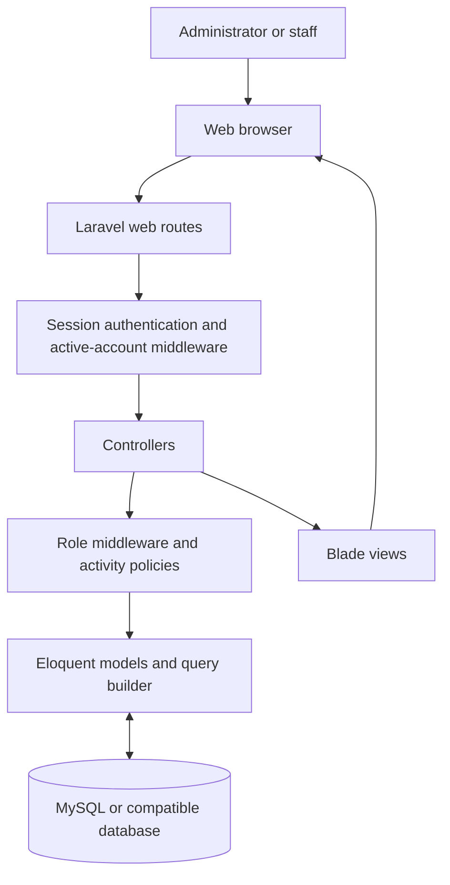
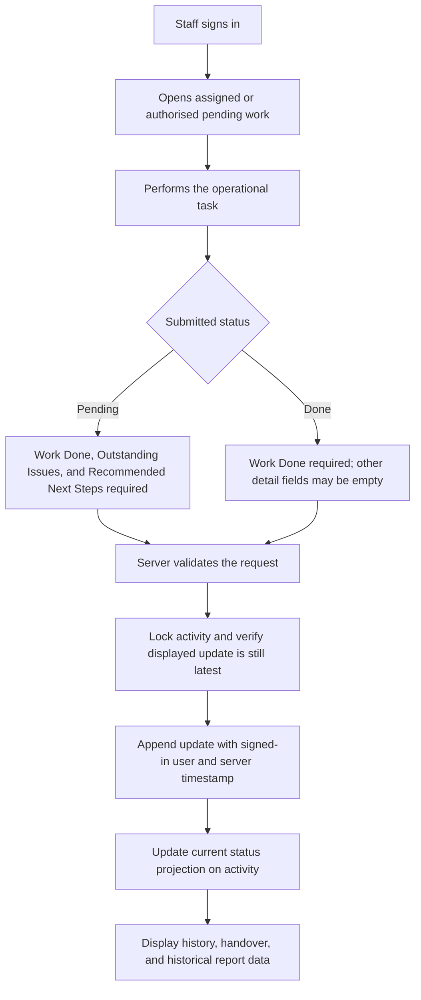
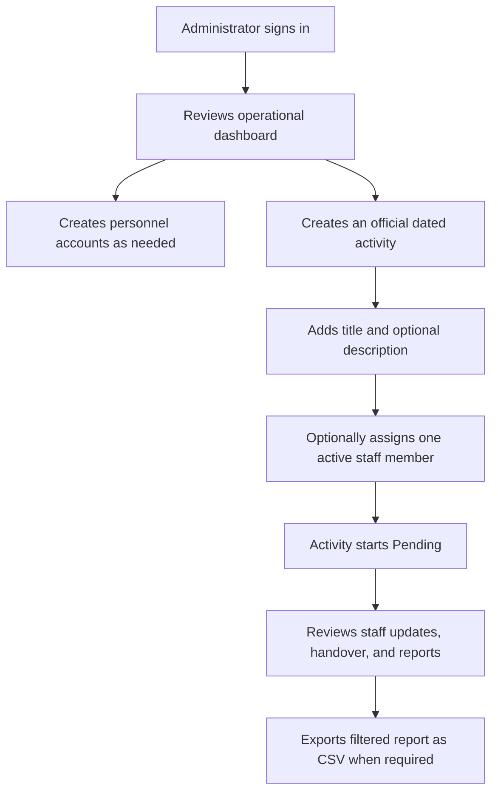

# Architecture

This document describes the implemented Laravel application and its request, activity-update, handover, and administrator workflows.

## System architecture

### Layer responsibilities

- **Presentation:** Blade templates render dashboards, forms, activity details, handover views, history, and reports. The current interface uses CSS served from `public/css`.
- **Application:** Controllers validate HTTP input, coordinate activity and personnel workflows, query models, and return views or downloads.
- **Authentication and authorization:** Laravel session authentication protects workspace routes. The active-account middleware rejects deactivated accounts; administrator middleware protects personnel management; `ActivityPolicy` controls activity visibility and updates.
- **Data:** Eloquent models represent users, activities, and activity updates. Migrations define domain tables and Laravel support tables in the configured database.

The application timezone is set by `APP_TIMEZONE` in `config/app.php`; the example default is `Africa/Accra`. Handover and report status cutoffs use that timezone.

## Activity update workflow

Work Done is required for every update; Findings is optional. The controller builds the update from validated fields and the authenticated user. If another update arrives after a staff member opens the form, the stale submission is rejected so they can review the latest history before resubmitting.

## Administrator activity-management workflow

Activities are created through the administrator workflow and begin Pending. The current activity routes provide list, create, store, and show operations; there is no activity edit or delete route. Assignment supports one optional staff user at creation time, not a team or multiple assignees. Administrators can review activity data but cannot submit staff updates.

## Domain and history model

- **User:** has an `admin` or `staff` role, an active state, and relationships to activities created, activities assigned, and updates submitted.
- **Activity:** a dated support-work record with a creator, optional assignee, and a current status value.
- **Activity update:** a separate record linked to an activity. It contains submitted status, structured work details, personnel identity snapshot, and timestamps.

Each update is appended rather than overwriting prior update details. The current `activities.status` is a projection for routine current-state lists. A historical handover or report must determine status from the latest update at or before its selected date boundary, not from this current projection. No handover table or unplanned support-issue table exists.

## Handover and reporting

For a selected handover date, the controller includes eligible activities dated on or before that date and created by the end of that day. It considers only updates timestamped by that same end-of-day boundary. The last eligible update determines the historical status and displayed details; an activity with no update is **Awaiting Update**. Pending and awaiting work carries forward, while a Done update ends carryover until a later Pending update reopens the same activity.

Reports filter on inclusive activity dates and can filter by personnel, exact activity, title text, and status as of the selected end date. CSV export uses the same filters and access scope. Staff views are scoped more narrowly than administrator views.

## Authorization summary

- All application workspace routes require an authenticated session.
- Personnel routes require the administrator middleware.
- Activity creation is administrator-only.
- Staff can view/update activities they created or were assigned, and can continue currently Pending team activities. Access to pending work is not based on reassignment.
- Activity history and reports enforce role-specific scopes in their queries.
- Hiding a link in a view is not sufficient access control; authorization must remain in middleware, policies, and controllers.

See [DATABASE-DESIGN.md](DATABASE-DESIGN.md) for table definitions and [SECURITY.md](SECURITY.md) for the controls' limitations.

## Frontend assets

`resources/views/layouts/app.blade.php` loads the styles used by the application from `public/css`. Source styles also exist in `resources/css`; keep directly served styles aligned when changing the interface. Vite is available for an optional asset build, but the current interface does not require it.
