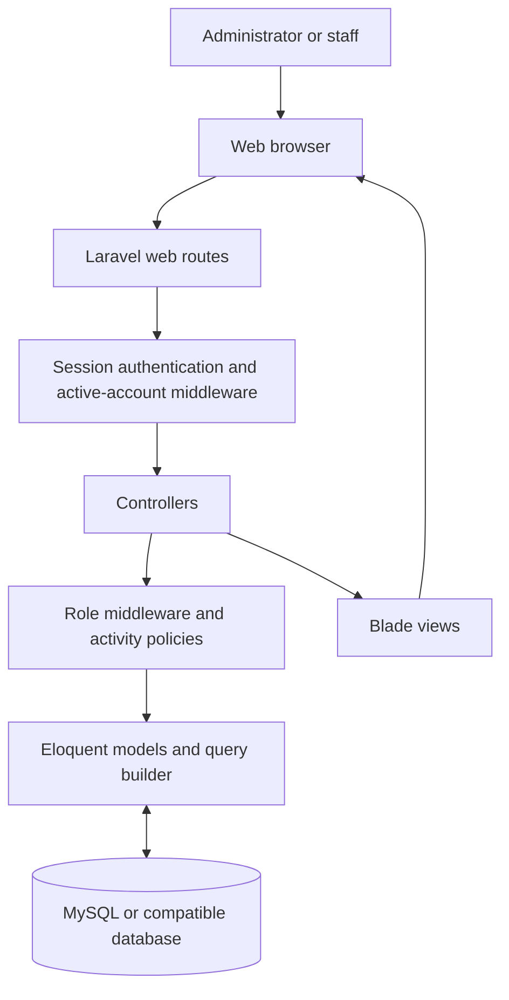
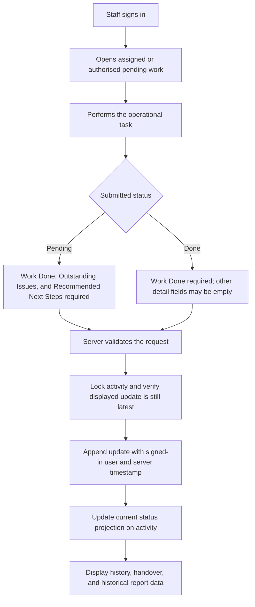
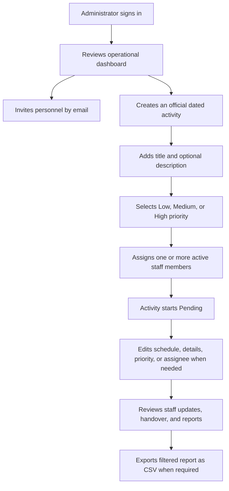

# Architecture

This document describes the implemented Laravel application and its request, activity-update, handover, and administrator workflows.

## System architecture

### Layer responsibilities

- **Presentation:** Blade templates render dashboards, forms, activity details, issue reports, handover views, history, and reports. The current interface uses CSS served from `public/css`.
- **Application:** Controllers validate HTTP input, coordinate activity and personnel workflows, query models, and return views or downloads.
- **Authentication and authorization:** Laravel session authentication protects workspace routes. The active-account middleware rejects deactivated accounts; administrator middleware protects personnel management; `ActivityPolicy` controls activity visibility and updates.
- **Data:** Eloquent models represent users, activities, activity assignments, activity updates, and support-issue reports. Migrations define domain tables and Laravel support tables in the configured database.

The application timezone is set by `APP_TIMEZONE` in `config/app.php`; the example default is `Africa/Accra`. Handover and report status cutoffs use that timezone.

## Activity update workflow

Work Done is required for every update; Findings is optional. The controller builds the update from validated fields and the authenticated user. If another update arrives after a staff member opens the form, the stale submission is rejected so they can review the latest history before resubmitting.

## Administrator activity-management workflow

Activities are created through the administrator workflow and begin Pending. Priority may be High, Medium, or Low; new activities default to Medium. Administrators can edit the activity title, description, activity date, priority, and assignees. New assignees must be active staff accounts. Existing legacy assignments can be retained or replaced. The `activity_assignees` pivot is authoritative for team assignments; `activities.assigned_to` remains a compatibility projection of the first assignee. Administrators cannot change activity status through the details form; status changes remain staff updates. Rescheduling changes activity-date filters but does not rewrite update timestamps. Activity deletion is not available. Administrators can review activity data but cannot submit staff updates.

## Domain and history model

- **User:** has an `admin` or `staff` role, an active state, an invitation/password-change state, and relationships to activities created, activities assigned, and updates submitted.
- **Activity:** a dated support-work record with a creator, zero or more assignees, a current status value, and a current priority value.
- **Activity update:** a separate record linked to an activity. It contains submitted status, structured work details, personnel identity snapshot, and timestamps.
- **Support issue report:** an unplanned issue record with reporter, title, optional affected service, description, priority, status, and optional resolution notes.

Each update is appended rather than overwriting prior update details. Administrator edits to activity metadata update the activity record and do not create an activity-update event; the update history is preserved, but previous metadata values are not reconstructable from that history. The current `activities.status` is a projection for routine current-state lists. A historical handover or report must determine status from the latest update at or before its selected date boundary, not from this current projection. Support issues are stored separately from scheduled activities; no handover table is required.

## Unplanned support-issue workflow

Authenticated staff and administrators can submit an issue report with a title, description, priority, and optional affected service. A report is visible only to its reporter and administrators. Administrators can change its status among Open, In Progress, and Resolved; resolution requires resolution notes. Issue reports do not create or alter activities.

## Invitation and password workflow

Administrators create an account by sending a single-use password-setup link to the submitted email address. Self-service reset uses Laravel's password broker and returns a generic response to avoid confirming whether an address has an account. Password setup/reset links set the account's email verification timestamp. Administrator-issued temporary passwords set a first-login password-change flag, enforced by authenticated-route middleware until the user changes their password. Real delivery requires a configured mail transport and correct `APP_URL`.

## Handover and reporting

For a selected handover date, the controller includes eligible activities dated on or before that date and created by the end of that day. It considers only updates timestamped by that same end-of-day boundary. The last eligible update determines the historical status and displayed details; an activity with no update is **Awaiting Update**. Pending and awaiting work carries forward, while a Done update ends carryover until a later Pending update reopens the same activity.

Within each status group, handover displays High, Medium, then Low priority activities before sorting by title. The priority filter selects current activity priority; priority is not reconstructed historically.

Reports filter on inclusive activity dates and can filter by priority, personnel, exact activity, title text, and status as of the selected end date. CSV export includes priority and uses the same filters and access scope. Staff views are scoped more narrowly than administrator views.

## Authorization summary

- All application workspace routes require an authenticated session.
- Personnel routes and activity detail-edit routes require the administrator middleware.
- Activity creation and editing are administrator-only.
- Staff can view/update activities they created or were assigned, and can continue currently Pending team activities. Access to pending work is not based on reassignment.
- Activity history and reports enforce role-specific scopes in their queries.
- Hiding a link in a view is not sufficient access control; authorization must remain in middleware, policies, and controllers.

See [DATABASE-DESIGN.md](DATABASE-DESIGN.md) for table definitions and [SECURITY.md](SECURITY.md) for the controls' limitations.

## Frontend assets

`resources/views/layouts/app.blade.php` loads the styles used by the application from `public/css`. Source styles also exist in `resources/css`; keep directly served styles aligned when changing the interface. Vite is available for an optional asset build, but the current interface does not require it.
