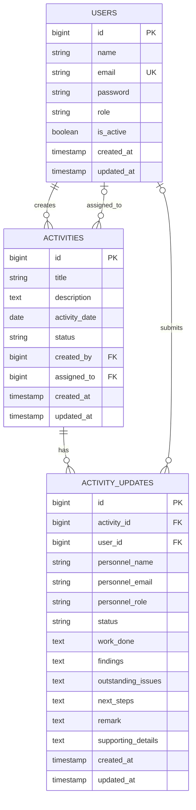

# Database Design

This document describes the tables created by the repository's migrations. Laravel Blueprint types are shown in their logical form; the physical SQL types can vary by database driver. The documented setup uses MySQL or compatible MariaDB.

## Entity relationship diagram

`ACTIVITY_UPDATES.user_id` and `ACTIVITIES.assigned_to` are nullable. The `personnel_*` snapshot fields preserve the identity displayed in history if the linked account is later removed. Account deactivation does not delete the account or its update records.

## Domain tables

### `users`

| Column | Type | Constraints and purpose |
| --- | --- | --- |
| `id` | BIGINT auto-increment | Primary key. |
| `name` | VARCHAR(255) | Required personnel name. |
| `email` | VARCHAR(255) | Required; unique index. |
| `email_verified_at` | TIMESTAMP nullable | Optional email verification timestamp. |
| `password` | VARCHAR(255) | Hashed password value. |
| `role` | VARCHAR(255) | Default `staff`; indexed. Application values are `admin` and `staff`; the database column is not an enum. |
| `is_active` | BOOLEAN | Default `true`; indexed. |
| `remember_token` | VARCHAR(100) nullable | Laravel session remember token. |
| `created_at`, `updated_at` | TIMESTAMP nullable | Laravel-managed model timestamps. |

### `activities`

| Column | Type | Constraints and purpose |
| --- | --- | --- |
| `id` | BIGINT auto-increment | Primary key. |
| `title` | VARCHAR(255) | Activity title. |
| `description` | TEXT nullable | Optional context. |
| `activity_date` | DATE | Indexed; date the activity belongs to. |
| `status` | VARCHAR(255) | Default `Pending`; indexed. Current status projection, not the source for historical status. |
| `created_by` | BIGINT unsigned | Required foreign key to `users.id`; deletion is restricted. |
| `assigned_to` | BIGINT unsigned nullable | Optional foreign key to `users.id`; set to null if that user is deleted. |
| `created_at`, `updated_at` | TIMESTAMP nullable | Record creation and modification timestamps. |

No priority column exists. The schema supports one optional assignee per activity.

### `activity_updates`

| Column | Type | Constraints and purpose |
| --- | --- | --- |
| `id` | BIGINT auto-increment | Primary key. |
| `activity_id` | BIGINT unsigned | Required foreign key to `activities.id`; deletion is restricted. |
| `user_id` | BIGINT unsigned nullable | Optional foreign key to `users.id`; set to null if the user is deleted. |
| `personnel_name` | VARCHAR(255) | Submitter name snapshot. |
| `personnel_email` | VARCHAR(255) | Submitter email snapshot. |
| `personnel_role` | VARCHAR(255) nullable | Submitter role snapshot. |
| `status` | VARCHAR(255) | Submitted status; indexed. Application accepts `Pending` or `Done`. |
| `remark` | TEXT | Legacy/general remark field. New application updates populate it from Work Done. |
| `supporting_details` | TEXT nullable | Earlier optional supporting-detail field retained for existing data. |
| `work_done` | TEXT nullable | Structured Work Done field. New submissions require it. |
| `findings` | TEXT nullable | Optional structured findings. |
| `outstanding_issues` | TEXT nullable | Required by application validation for Pending updates; nullable in schema and may be empty for Done. |
| `next_steps` | TEXT nullable | Recommended Next Steps; required for Pending updates and optional for Done. |
| `created_at`, `updated_at` | TIMESTAMP nullable | Laravel-managed timestamps; `created_at` is the event time used for history cutoffs. |

Indexes include `status`, `(activity_id, created_at)`, and `(user_id, created_at)`. Updates are separate rows so subsequent status changes preserve earlier remarks, status, attribution, and recorded time. The schema itself does not make rows cryptographically or database-level immutable; the normal application routes expose no update/delete operation for submitted updates.

## Foreign keys and delete behavior

| Relationship | Foreign key | On delete |
| --- | --- | --- |
| User creates activities | `activities.created_by` → `users.id` | Restrict |
| User is assigned an activity | `activities.assigned_to` → `users.id` | Set null |
| Activity has updates | `activity_updates.activity_id` → `activities.id` | Restrict |
| User submits updates | `activity_updates.user_id` → `users.id` | Set null |

## Laravel support tables

These are created by the default Laravel migrations and support configured framework drivers. They are not SupportTrack business records.

| Table | Columns and indexes |
| --- | --- |
| `migrations` | `id` UNSIGNED INTEGER auto-increment primary key; `migration` VARCHAR(255); `batch` INTEGER. Laravel's migration repository creates this ledger table when migrations are first run. |
| `password_reset_tokens` | `email` VARCHAR(255) primary key; `token` VARCHAR(255); nullable `created_at` TIMESTAMP. The application does not currently expose a password-reset flow. |
| `sessions` | `id` VARCHAR(255) primary key; nullable `user_id` BIGINT indexed (no foreign key is declared); nullable `ip_address` VARCHAR(45), `user_agent` TEXT; `payload` LONGTEXT; indexed `last_activity` INTEGER. |
| `cache` | `key` VARCHAR(255) primary key; `value` MEDIUMTEXT; indexed `expiration` INTEGER. |
| `cache_locks` | `key` VARCHAR(255) primary key; `owner` VARCHAR(255); indexed `expiration` INTEGER. |
| `jobs` | `id` BIGINT primary key; indexed `queue` VARCHAR(255); `payload` LONGTEXT; `attempts` UNSIGNED TINYINT; nullable `reserved_at` UNSIGNED INTEGER; `available_at` and `created_at` UNSIGNED INTEGER. |
| `job_batches` | `id` VARCHAR(255) primary key; `name` VARCHAR(255); `total_jobs`, `pending_jobs`, `failed_jobs` INTEGER; `failed_job_ids` LONGTEXT; nullable `options` MEDIUMTEXT; nullable `cancelled_at` and `finished_at` INTEGER; `created_at` INTEGER. |
| `failed_jobs` | `id` BIGINT primary key; `uuid` VARCHAR(255) unique; `connection` and `queue` TEXT; `payload` and `exception` LONGTEXT; `failed_at` TIMESTAMP defaulting to current time. |

Laravel also maintains its migration ledger table to track which migrations have run.

## Handover and reporting data rules

Handover is computed from an activity and its updates; there is no `handovers` table. For a selected date, only activity records created by the end of that date and updates timestamped by that boundary are considered. The latest eligible update supplies the status. No eligible update yields **Awaiting Update**. Pending and awaiting work can carry forward; Done work stops carrying forward unless a later update reopens it as Pending.

Reports filter by inclusive activity dates and use the selected end date as the status/update cutoff. The status displayed for a past date must therefore be reconstructed from `activity_updates`, not read solely from `activities.status`.

## Not represented in the schema

There are no priority, support-issue-report, multi-assignee, or handover-specific tables in the current migrations.
